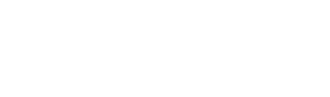

# LemmyPet
Lemmy 🤘

<p align="center"></p>

A tiny pixel-art Lemmy that lives on your Windows desktop. He wanders around,
naps, sulks when the mouse gets too close and types on his laptop while you type.
He never steals focus and clicks go right through him.

## Features

- **Wanders the desktop**: walks, idles, sleeps (with floating "Zzz") and bumps
  into screen edges.
- **Reacts to the mouse**: fades out when the cursor comes near, then teleports
  to the bottom-right corner, flees to a corner, or ignores it.
- **Types along with you**: when you type, he pulls out his laptop and a speech
  bubble spells Lemmy lines, one character per keystroke. The real keys are
  never shown.
- **Spider-Man mode**: in the "screen edges" zone, he walks on the walls and the
  ceiling, rolling smoothly around corners from one edge to the next.
- **Draggable** (optional): grab him with the mouse and drop him elsewhere.
- **More pets**: any pet described in `pets/` lives on the desktop at the
  same time, with its own settings (see [Adding a pet](#adding-a-pet)).
- **Collisions** (optional): pets bump into each other, bounce off and sulk
  at each other for a moment.
- **Single instance**, settings saved in the registry
  (`HKCU\Software\LemmyPet\Pets\<id>`), optional start with Windows.

## Usage

Run `LemmyPet.exe`, with the `pets` folder next to it. Everything is
controlled from the notification-area icon:

- **Click**: opens the settings window, pets listed on the left
  (Ctrl+Tab to switch); changes apply right away. "Run at startup" and "Quit
  LemmyPet" are at the bottom.
- **Right-click**: "Settings...", show / hide all pets, "Quit".

| Pet setting                         | Options                                   |
| ----------------------------------- | ----------------------------------------- |
| Visible                             | Show or hide this pet                     |
| Size                                | Slider, x0.5 to x8 by 0.05 (default x2)   |
| Speed                               | Slider, 20% to 400% by 5% (default 100%)  |
| Activity                            | Lazy, Normal, Hyperactive                 |
| When the mouse approaches           | Teleport bottom-right, flee, ignore       |
| Opacity                             | 100% to 20%                               |
| Roaming zone                        | Anywhere, screen edges, bottom of screen  |
| White halo                          | 1 px white outline around him             |
| Zzz while sleeping                  | Show "Zzz" while sleeping                 |
| Draggable with the mouse            | Allow dragging him                        |
| Sleep when the mouse is idle        | Falls asleep after 30 s of mouse idle     |
| Type on his laptop when I type      | Types while you type                      |
| Bubble with his lines               | Speech bubble while typing                |
| Spider-Man mode (feet on the edges) | Walls and ceiling (screen edges zone)     |
| Collide with other pets             | Bumps into pets that have it too, angry   |

### Custom lyrics

Lemmy's bubble cycles through the Motörhead song titles of
`pets/lemmy/lyrics.txt`: edit it to use your own lines (UTF-8, one line per
bubble, lines starting with `#` are comments).

## Adding a pet

Each pet is a folder `pets/<id>/` holding a `pet.ini` and the PNG sprite
sheets it names; LemmyPet loads them all at startup and reports the broken
ones. `pets/lemmy/pet.ini` uses a grid of cells, `pets/snorlax/pet.ini`
a PMD sprite plus a hand-made laptop sheet.

```ini
; ';' or '#' start comments.
[pet]
name = Lemmy            ; shown in the settings list (default: the folder name)
sheet = lemmy.png       ; default sheet of every animation
cell = 45               ; frame box in sprite px ("w,h" also works); default: the largest frame
                        ; (the box he is drawn in is made square, for walls and corners)
halo = 1                ; default of his "White halo" setting (0: off)
zzz = 26,12             ; where the Z's start in the cell, head on the right (default: above
                        ; the head of the first sleep frame)
lyrics = lyrics.txt     ; lines typed in his bubble (none: no bubble)

[walk]                  ; required
cycle = 1,2,3,2         ; frame order (default: each frame in turn)
stand = 2               ; frame shown while idle (default: 1)
S = 0,0 1,0 2,0
W = 0,1 1,1 2,1
```

- **Animations**: `[walk]`, `[idle]` (standing still), `[sulk]` (cursor
  came too close), `[hurt]` (bumped or dragged), `[sleep]`, `[type]`
  (laptop), `[play]` (now and then while idle, played once) and `[turn]`
  (turning on the spot before walking off another way: frame *i* of facing
  *f* shows facing *f + i* clockwise, like PMD's Rotate). Each one
  may set its own `sheet`, `cycle`, `durations` (ms of each step of the
  cycle, at 100 % speed) and `loop = 0` (plays once, then holds the last
  frame). They start over with each new state. A missing one shows him
  standing (walk frame `stand`); without `[type]` he never types, without
  `[play]` he never plays, without `[turn]` he turns at once.
- **Facings**: one key per direction, `S SW W NW N NE E SE`, each listing
  frames separated by spaces. Missing facings borrow from the closest one:
  `SW` and `NW` from `W`, then `W` from `E` mirrored, and so on. `[sleep]`
  uses `E` (head on the right) and `W`; `[type]` uses `S`, `W` and `E`.
- **Frames**: `x,y,w,h` (a rectangle of the sheet) or `col,row` (a grid cell,
  needs `cell`). A leading `~` mirrors the frame. Frames are drawn
  bottom-centered in the cell.
- **Scale**: the settings size is a multiple of the sheet pixels (crisp at
  whole multiples).

### PMD sprites

A [PMDCollab SpriteCollab](https://github.com/PMDCollab/SpriteCollab) sprite
folder (`AnimData.xml` and its `<Name>-Anim.png` sheets) is read as is:

```ini
[pet]
pmd = AnimData.xml      ; sections may then play its animations

[walk]
anim = Walk             ; instead of the facing keys: all 8 facings, its frame durations

[sulk]
anim = Attack, Shoot    ; several: one picked at random each time
cycle = 1,2             ; frames of each to play (the frame width fits just those)
durations = 250,250     ; overrides their durations

[play]
anim = Hop, Swing
inplace = x             ; on the spot: x (keeps jumps) or xy, after his body marks (<Name>-Offsets.png)

[sleep]
anim = Sleep
facing = E              ; facing of a one-row sheet (default: S)
```

Each frame keeps the sprite anchor (the frame center) at the same place,
his feet on the lowest row of the first PMD animation (normally `[walk]`):
frames above it stay in the air (hops), frames going lower are raised onto
the floor (lunges toward the viewer). `tools/import_pmd.py <dex> <id> <name>
[--sleep-head left|right]` downloads such a folder into `pets/<id>/` with a
`pet.ini` using every animation (the ones no other section takes go to
`[play]`, sulking on the spot, playing on the spot but still jumping; CC
BY-NC 4.0, credits in `credits.txt`); re-importing keeps its
`lyrics` file and a `[type]` section with its own `sheet`.

## Build

Cross-compiled with MinGW-w64 (e.g. from Linux or WSL):

```sh
make
```

Requires `x86_64-w64-mingw32-g++`, and Python 3 with Pillow to regenerate the
assets. Lemmy's sprite sheet `pets/lemmy/lemmy.png` and the icon are rebuilt
from `sprites/` when needed:

| Script                  | Output                                    |
| ----------------------- | ----------------------------------------- |
| `tools/make_sheet.py`   | `pets/lemmy/lemmy.png` (`--preview` for a zoomed copy) |
| `tools/pad_sheet.py`    | `pets/lemmy/lemmy.png` from the hand-edited `lemmy_save.png` |
| `tools/make_icon.py`    | `src/app.ico`                             |
| `tools/make_demo.py`    | `demo.gif` shown above                    |
| `tools/import_pmd.py`   | `pets/<id>/` from a SpriteCollab sprite   |

## License

See [LICENSE](LICENSE).
